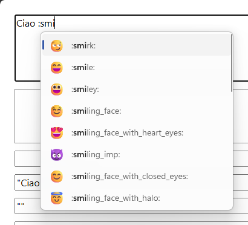
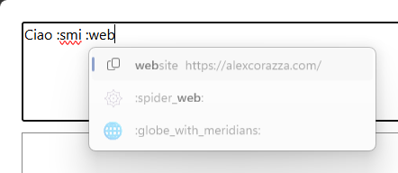
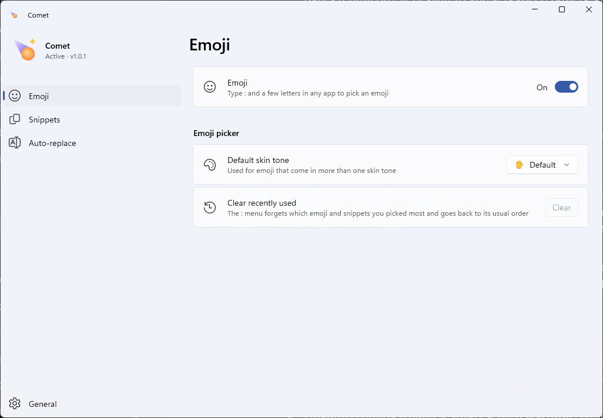
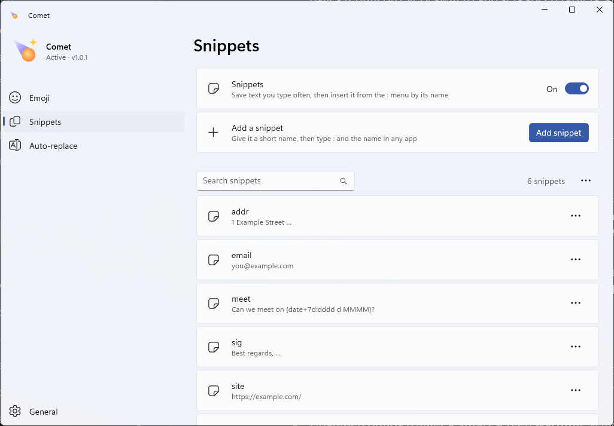
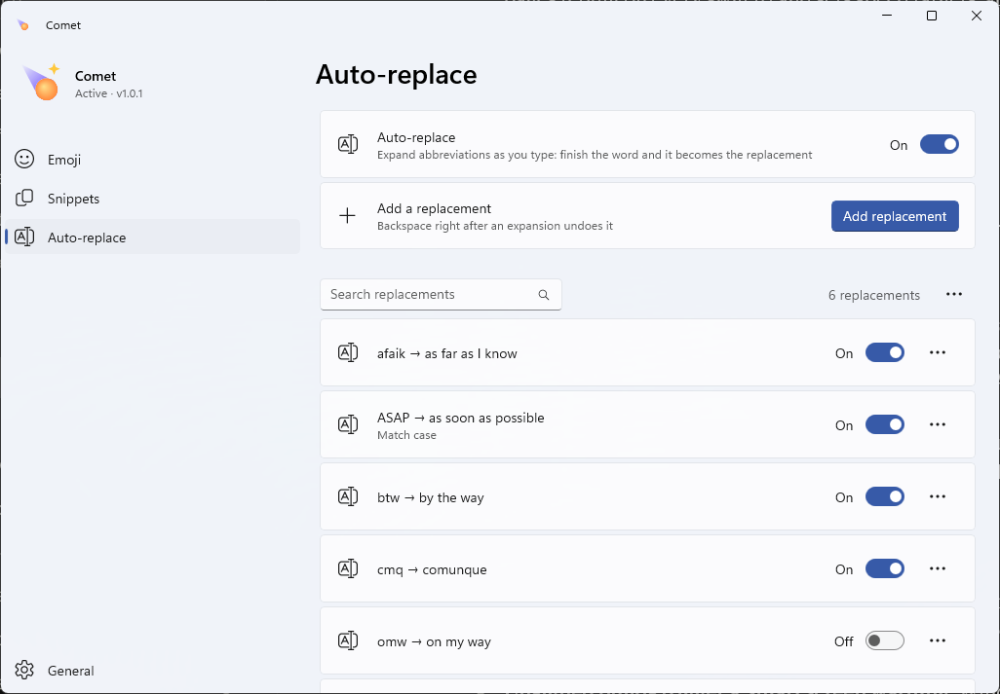
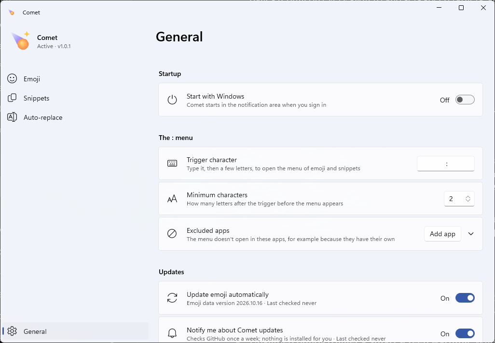

<div align="center">


# Inlay

**Slack-style emoji, snippets and shorthands for any app on Windows 11.**

[](https://github.com/Alexciao/inlay/releases/latest)
[](https://github.com/Alexciao/inlay/actions/workflows/ci.yml)
[](LICENSE)


<picture>
  <source media="(prefers-color-scheme: dark)" srcset="docs/images/popup-dark.png">
  
</picture>

</div>

> [!NOTE]
> **Notice on AI-generated code**<br>
> Most of Inlay's code was written with the help of AI coding agents.<br>
> Extensive unit testing and manual testing was performed to help avoid bugs and keep a high quality bar for the app.<br>
> Inlay is private: it works fully offline. No keystrokes are ever logged or sent to any servers. The only optional network requests it performs are to GitHub servers to check for updates for emoji data and for Inlay itself.<br>
> Any feature, including these requests, is fully toggleable in Settings.<br>
> Inlay is modular, fast and lightweight, and every feature you don't need can be fully disabled.

## Features

### Emoji picker
Type `:` and two letters in any text field and a list of emoji appears at the caret. Keep typing to filter; search
knows GitHub and Slack shortcodes, Unicode names and everyday words (`:love`, `:lol`), forgives typos (`:thnmbs`)
and abbreviations (`:hrt`), and learns what you use. Typing a whole code such as `:fire:` replaces it directly.

| Key | Does |
|---|---|
| `:` + letters | opens the list (two letters by default) |
| ↑ / ↓, Tab / Shift+Tab | move the selection |
| Enter or Tab | insert the selected emoji |
| Esc | close the list |
| `:code:` or `:code` + space | insert that exact emoji |

Your default skin tone is applied automatically. Apps with their own `:` picker (Slack, Discord, Teams, Telegram)
are excluded by default.

### Snippets
Saved text with a short name, offered in the same `:` list: `:addr` becomes your address.

<picture>
  <source media="(prefers-color-scheme: dark)" srcset="docs/images/snippet-dark.png">
  
</picture>

| Placeholder | Inserts |
|---|---|
| `{date}`, `{time}` | today's date, the current time |
| `{date:dddd d MMMM yyyy}` | a date or time in any .NET format |
| `{date+7d}`, `{date-1d}`, `{date+2w}`, `{date+1m}` | an offset date (`{date+1d:dd/MM}` with a format) |
| `{weekday}` | today's weekday |
| `{clipboard}` | the text on the clipboard |
| `{cursor}` | where the caret ends up |
| `{{`, `}}` | literal braces |

### Shorthands
Abbreviations that expand when you finish the word: `btw` + space becomes `by the way `. The replacement follows
how you typed it (`Btw` → `By the way`, `BTW` → `BY THE WAY`) unless *Match case exactly* is on, and the space,
Enter or punctuation you typed is kept. **Backspace** right after an expansion undoes it. Each app can be excluded.

Emoji, Snippets and Shorthands can each be switched off; Pause from the tray stops everything. Inlay never takes
focus, and stays out of password fields, apps running as administrator and IME input.

## Install

| | x64 | Arm64 |
|---|---|---|
| **Installer** (per user, no admin rights) | [Inlay-Setup-x64.exe](https://github.com/Alexciao/inlay/releases/latest/download/Inlay-Setup-x64.exe) | [Inlay-Setup-arm64.exe](https://github.com/Alexciao/inlay/releases/latest/download/Inlay-Setup-arm64.exe) |
| **Portable** (unzip and run; data stays in the folder) | [Inlay-Portable-x64.zip](https://github.com/Alexciao/inlay/releases/latest/download/Inlay-Portable-x64.zip) | [Inlay-Portable-arm64.zip](https://github.com/Alexciao/inlay/releases/latest/download/Inlay-Portable-arm64.zip) |

Checksums: [SHA256SUMS.txt](https://github.com/Alexciao/inlay/releases/latest/download/SHA256SUMS.txt).

**Requirements:** Windows 11 (build 22000 or later). Windows 10 is not supported: the installer and the app
require Windows 11, and it hasn't been tested there.

**SmartScreen:** the builds aren't code-signed yet, so Windows may say it protected your PC. Click **More info** →
**Run anyway**.

## Settings

Left-click the tray icon (or start Inlay again) to open Settings. Changes apply and save at once.

| | |
|---|---|
| <picture><source media="(prefers-color-scheme: dark)" srcset="docs/images/settings-emoji-dark.png"></picture> | **Emoji:** switch the picker on or off, choose the default skin tone, clear recently used emoji. |
| <picture><source media="(prefers-color-scheme: dark)" srcset="docs/images/settings-snippets-dark.png"></picture> | **Snippets:** add, search, edit, duplicate, import and export snippets, with a live preview. |
| <picture><source media="(prefers-color-scheme: dark)" srcset="docs/images/settings-autoreplace-dark.png"></picture> | **Shorthands:** your abbreviations, each with its own switch, and the apps where they don't expand. |
| <picture><source media="(prefers-color-scheme: dark)" srcset="docs/images/settings-general-dark.png"></picture> | **General:** start with Windows, the trigger character and minimum letters, excluded apps, updates, backup and about. |

## Performance

Release build (Native AOT), measured; details in [docs/performance.md](docs/performance.md).

| | |
|---|---:|
| Keystroke → popup on screen (p95) | 12.5 ms |
| Search, worst case per keystroke | 0.32 ms |
| Start → ready | 113–148 ms |
| Tray click → Settings drawn (warm / first) | 154–168 ms / 217–243 ms |
| CPU while idle | ≈ 0 (Inlay's threads: 0 cycles) |
| Download (installer) | 18 MB |

## Privacy

Inlay contacts exactly two addresses, once a week each, with only a `User-Agent: Inlay/<version>` header:

| Address | Why | Turn off |
|---|---|---|
| `https://github.com/Alexciao/inlay/releases/download/emoji-data/manifest.json` | newer emoji data | Settings › General › Update emoji automatically |
| `https://api.github.com/repos/Alexciao/inlay/releases/latest` | newer Inlay version (it only tells you) | Settings › General › Notify me about Inlay updates |

Neither runs while Inlay is paused or on a metered connection. A test fails the build if any other network code
appears. The local log in `%LocalAppData%\Inlay\logs` records events and timings, never typed text.

## Build from source

Prerequisites: the [.NET 10 SDK](https://dotnet.microsoft.com/download), Visual Studio 2022 Build Tools with the
**Desktop development with C++** workload (for Native AOT), and the Windows 11 SDK (10.0.26100).

```pwsh
dotnet build Inlay.sln                      # Debug build
dotnet test tests/Inlay.Core.Tests          # unit tests incl. the search golden set
dotnet test tests/Inlay.Platform.Tests
./installer/build.ps1 -Version 1.0.0        # Native AOT publish, installer and portable zip (needs Inno Setup 6)
```

The end-to-end tests (`tests/Inlay.E2E`) drive a real desktop with real keystrokes; run them when you're away from
the keyboard. The solution opens in Rider or Visual Studio.

## License and acknowledgements

[MIT](LICENSE). Inspired by [Rocket](https://matthewpalmer.net/rocket/) for macOS. Emoji data from
[emojibase](https://github.com/milesj/emojibase), [gemoji](https://github.com/github/gemoji),
[emojilib](https://github.com/muan/emojilib) and [Unicode CLDR](https://cldr.unicode.org/); see
[THIRD-PARTY-NOTICES.md](THIRD-PARTY-NOTICES.md).
