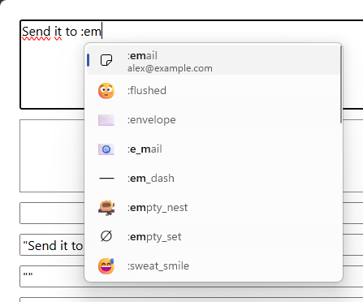
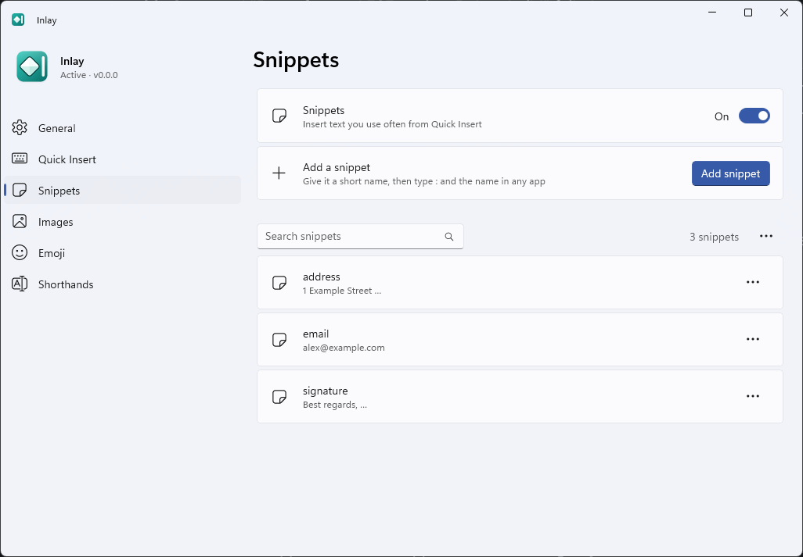
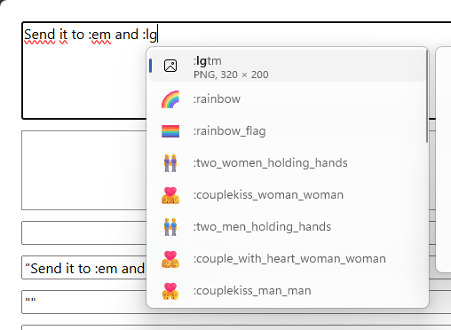
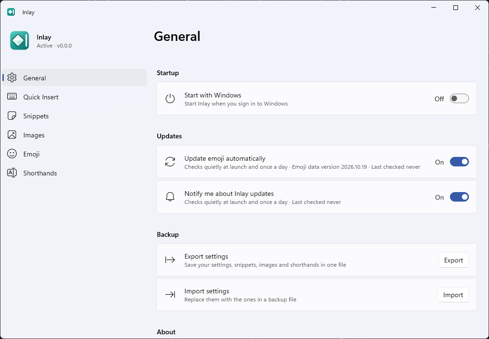

<div align="center">


# Inlay

**Everything you reach for, right where you type.**

[](https://github.com/Alexciao/inlay/releases/latest)
[](https://github.com/Alexciao/inlay/actions/workflows/ci.yml)
[](LICENSE)


</div>

Inlay runs in the system tray and works in any app. Type `:` followed by a few letters to open a menu of your snippets, images, emoji and symbols, then press Enter to insert one. You can also set up shorthands, which expand as you type without opening a menu.

<picture>
  <source media="(prefers-color-scheme: dark)" srcset="screenshots/quick-insert-dark.png">
  
</picture>

> [!NOTE]
> **Notice on AI-generated code**
>
> Most of Inlay's code was written with the help of AI coding agents. It is covered by extensive unit and end-to-end tests, and every feature was also tested by hand to keep the quality bar high.
>
> Inlay works fully offline. It never logs what you type and never sends it anywhere. The only network requests are two optional update checks to GitHub (emoji data and new Inlay versions), made quietly at launch and once a day, which you can turn off in Settings.

## Features

### Quick Insert

Type `:` and two letters in any text field to open Quick Insert next to the cursor. Keep typing to narrow the list, use the arrow keys to choose, and press Enter or Tab to insert. Search tolerates typos and puts the items you use most at the top. You can also open Quick Insert with **Win+Alt+I**.

You can choose, per app, whether Quick Insert shows everything, only your own snippets and images, or nothing at all. Chat apps that have their own emoji picker, such as Slack, Discord and Teams, show only your own items by default.

#### Snippets

A snippet is a piece of text saved under a name, such as `:email` for your email address. Snippets can contain placeholders for the date, the time, the clipboard and where the cursor should end up. The snippet editor's **Insert placeholder** menu lists them all.

<picture>
  <source media="(prefers-color-scheme: dark)" srcset="screenshots/settings-snippets-dark.png">
  
</picture>

#### Images

Images and GIFs can be saved under a name and inserted the same way as snippets. A name can point to a single image or to a folder, in which case Inlay inserts the newest image, a random one, or lets you choose. The **Latest screenshot** preset sets up `:screenshot` for your most recent screenshot. Each image can be inserted as a picture, as a file attachment, or as its file path.

<picture>
  <source media="(prefers-color-scheme: dark)" srcset="screenshots/quick-insert-images-dark.png">
  
</picture>

#### Emoji

Emoji can be found by their GitHub and Slack shortcodes and by everyday words. About 300 symbols are included as well, such as arrows, currency signs, dashes, fractions and Greek letters. You can set a default skin tone.

### Shorthands

A shorthand is an abbreviation that is replaced as soon as you finish the word, without a menu. Its capitalization follows yours, and pressing Backspace right after it undoes the replacement. Shorthands can be turned off in specific apps.

### Everything else

- Each feature can be turned off on its own, and **Pause** in the tray menu turns everything off for a while.
- Inlay never takes focus, and stays inactive in password fields, apps running as administrator, and while you type with an IME.
- **Export settings** saves your settings, snippets, shorthands and images to a single file that you can import on another PC.
- Inlay tells you when a new version is available, but never installs anything by itself.

## Install

Download the latest release:

- **Installer**, installs for your user only and doesn't need admin rights: [x64](https://github.com/Alexciao/inlay/releases/latest/download/Inlay-Setup-x64.exe) · [Arm64](https://github.com/Alexciao/inlay/releases/latest/download/Inlay-Setup-arm64.exe)
- **Portable**, unzip and run, with your data kept in the same folder: [x64](https://github.com/Alexciao/inlay/releases/latest/download/Inlay-Portable-x64.zip) · [Arm64](https://github.com/Alexciao/inlay/releases/latest/download/Inlay-Portable-arm64.zip)

Checksums are in [SHA256SUMS.txt](https://github.com/Alexciao/inlay/releases/latest/download/SHA256SUMS.txt).

Inlay requires Windows 11. The builds aren't code-signed yet, so SmartScreen may block the first launch. If it does, click **More info**, then **Run anyway**.

## Settings

Click the tray icon to open Settings. Changes are saved immediately.

<picture>
  <source media="(prefers-color-scheme: dark)" srcset="screenshots/settings-general-dark.png">
  
</picture>

| Page | Contents |
|---|---|
| General | Startup, update checks, export and import |
| Quick Insert | Trigger character, keyboard shortcut, recent items, per-app modes |
| Snippets | Your snippets |
| Images | Your images and folders |
| Emoji | Emoji and symbols, skin tone |
| Shorthands | Your shorthands and the apps they're turned off in |

## Performance

Quick Insert appears about 13 ms after you type, Inlay starts in under 150 ms, and it uses no CPU while idle. See [docs/performance.md](docs/performance.md) for how this was measured.

## Privacy

Inlay doesn't record or send what you type. It makes two requests to GitHub, at launch and once a day:

- `https://github.com/Alexciao/inlay/releases/download/emoji-data/manifest.json` checks for updated emoji data.
- `https://api.github.com/repos/Alexciao/inlay/releases/latest` checks for a new version of Inlay.

Both can be turned off in Settings › General, and neither runs while Inlay is paused or on a metered connection. The build fails if any other network code is added. Logs in `%LocalAppData%\Inlay\logs` contain events and timings, never typed text.

## Build from source

You need the [.NET 10 SDK](https://dotnet.microsoft.com/download), Visual Studio 2022 Build Tools with the **Desktop development with C++** workload, and the Windows 11 SDK (10.0.26100). Building the installer also needs Inno Setup 6.

```pwsh
dotnet build Inlay.sln
dotnet test tests/Inlay.Core.Tests
dotnet test tests/Inlay.Platform.Tests
./installer/build.ps1 -Version 1.1.0
```

The end-to-end tests in `tests/Inlay.E2E` send real keystrokes to your desktop, so don't use the computer while they run. Release notes are in [CHANGELOG.md](CHANGELOG.md).

## License and acknowledgements

Inlay is released under the [MIT License](LICENSE). It was inspired by [Rocket](https://matthewpalmer.net/rocket/) for macOS. Emoji data comes from [emojibase](https://github.com/milesj/emojibase), [gemoji](https://github.com/github/gemoji), [emojilib](https://github.com/muan/emojilib) and [Unicode CLDR](https://cldr.unicode.org/). See [THIRD-PARTY-NOTICES.md](THIRD-PARTY-NOTICES.md) for details.
